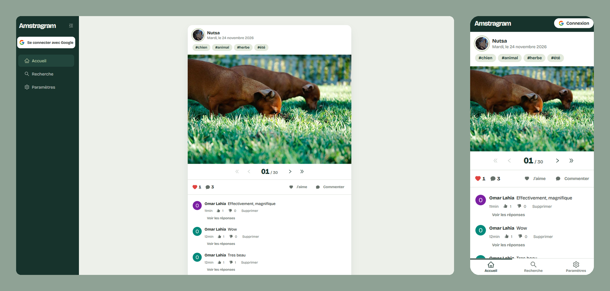

# Amstragram

<h3 align="center"><a href="README.md">Français</a> · <b>English</b></h3>

Personal project to learn React and Firebase. A photo app with Google sign-in, likes, comments and keyword search.

**Live site:** https://amstragram-01.web.app



## Features

- Sign in with a Google account
- Photo feed with navigation and a position counter
- Likes, comments and replies updated in real time
- Keyword search
- Editable profile page
- Layout adapted for desktop, tablet and mobile

## Technologies

React, Firebase (Authentication, Firestore, Hosting), Vite, Ant Design, Sass

## Run locally

First create a `.env.local` file from `.env.example`, with the configuration of a Firebase project.

```bash
npm install
npm run dev
```
