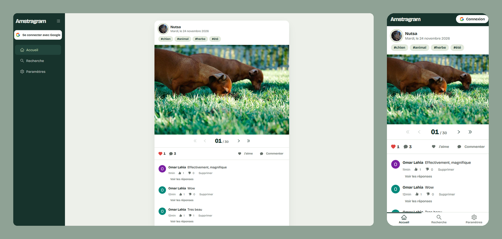

# Amstragram

<h3 align="center"><b>Français</b> · <a href="README.en.md">English</a></h3>

Projet personnel pour apprendre React et Firebase. Application de photos avec connexion Google, j'aime, commentaires et recherche par mot-clé.

**Site en ligne :** https://amstragram-01.web.app



## Fonctionnalités

- Connexion avec un compte Google
- Fil de photos avec navigation et compteur de position
- J'aime, commentaires et réponses mis à jour en temps réel
- Recherche par mot-clé
- Page de profil modifiable
- Mise en page adaptée à l'ordinateur, à la tablette et au téléphone

## Technologies

React, Firebase (Authentication, Firestore, Hosting), Vite, Ant Design, Sass

## Lancer en local

Il faut d'abord créer un fichier `.env.local` à partir de `.env.example`, avec la configuration d'un projet Firebase.

```bash
npm install
npm run dev
```
